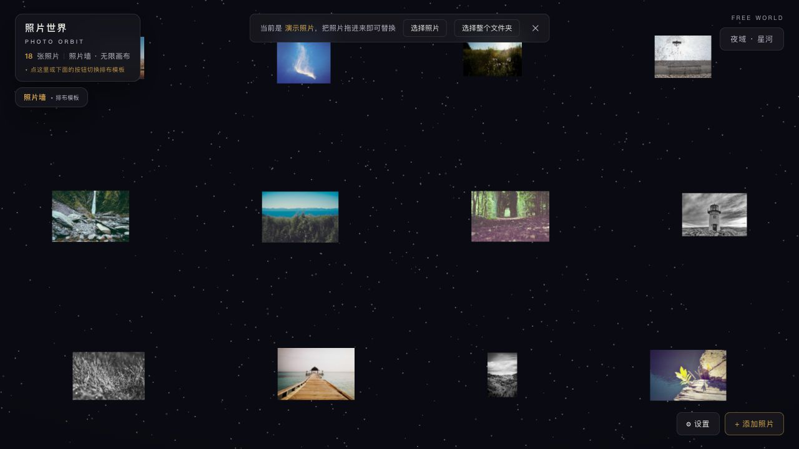

# Photo Orbit · 照片世界

**[Try the live demo](https://muzilun000-gif.github.io/photo-world/)** · [中文说明](README.zh-CN.md) · [Download ZIP](https://github.com/muzilun000-gif/photo-world/archive/refs/heads/main.zip)

Turn a folder of photos into an interactive 3D gallery in your browser. Start with 18 included demo photos, switch layouts, then drag in your own pictures. Your imported photos stay in this browser; there is no upload account or cloud photo storage.



[30-second demo GIF](demo.gif)

## Try it in one minute

1. Open the **live demo** in Chrome or Edge on Windows or macOS.
2. Let the demo photos load. Drag to look around; click a photo to focus it.
3. Use **排布模板** (Layout) or keys **1–9** to change the gallery. Press **M** to switch between white gallery and night sky.
4. Drag your own JPG/PNG/WebP photos into the window, or click **添加照片** (Add Photos). They replace the demo gallery.

The current interface is primarily Chinese. No installation is needed for the online demo. AI depth and gesture features load additional models; photos can still be viewed without those features. Neither the demo nor this README guarantees depth accuracy on every photo.

## Run locally on Windows or macOS

Download and extract the ZIP first. Keep `index.html`, `app.js`, `models/` and `samples/` together.

| Mode | Windows | macOS | What works |
| --- | --- | --- | --- |
| Basic viewing | Open `index.html` in Chrome/Edge | Open `index.html` in Chrome/Edge | Layouts, themes, local photo import; AI features may need an initial online download |
| Full local mode | Install Python 3, double-click `start-windows.bat` | Install Python 3, run `start-mac.command` | Serves bundled AI models locally; recording available after permission |

If Finder says the Mac launcher is not executable, run `chmod +x start-mac.command` in the extracted folder. You can also start directly:

```sh
# macOS
python3 scripts/serve.py
```

```bat
:: Windows
py -3 scripts\serve.py
```

The server listens only on `127.0.0.1:8000`. Stop it with Ctrl+C. If this port is busy, add `--port 8001`. Python is needed only for local-server mode, not for the live demo or basic viewing.

## Useful controls

| Action | Control |
| --- | --- |
| Look around / pan photo wall | Drag |
| Fly | W A S D; Space / C to rise / descend |
| Focus a photo / exit focus | Click / Esc |
| Previous / next photo | Left / right arrow |
| Layouts / theme / roam | 1–9 / M / T |
| Depth view / gesture control | V / G; gesture requires camera permission |
| Settings | ⚙ 设置 |

## Privacy and limitations

Photos and notes are saved in browser IndexedDB on the current computer and origin. **This is not a backup:** clearing site data or using a different browser/URL can make that local library unavailable. Keep your original files. Importing into the online demo does not upload photo contents to GitHub.

Bundled models support fully local processing when served locally. `file://` cannot load all models or use the microphone due to browser restrictions. Large libraries and AI inference use RAM/GPU resources. The repository includes about 91 MB of models. Windows and macOS checks verify the local server and assets; browser/GPU differences still need device testing.

## Build from source

Node.js 20+ is only needed when changing code:

```sh
npm ci
npm run check
npm run build
```

Edit `src/main.js`, rebuild `app.js`, and change its cache version in `index.html` when publishing. These commands use project-local dependencies on Windows and macOS. Do not rename the `photo-world` IndexedDB database when changing the product name.

## License and credits

Source code is [MIT](LICENSE). Demo photographs follow their own licenses; see [sample credits](samples/CREDITS.md). They are not covered by the code license. Dependencies retain their own licenses: three.js (MIT), MediaPipe and Depth-Anything-V2-Small (Apache-2.0), transformers.js and onnxruntime-web (Apache-2.0/MIT), heic2any/libheif (MIT/LGPL-3.0).

[Release history](docs/CHANGELOG.md) · [Report a bug](https://github.com/muzilun000-gif/photo-world/issues)
